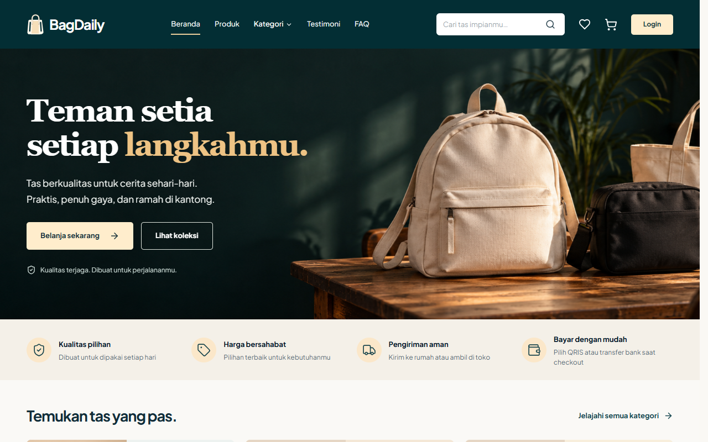

# BagDaily

**BagDaily** adalah aplikasi web yang menyatukan toko online dan kasir gerai fisik untuk UMKM tas.

## Kompetisi dan tim

| Informasi | Keterangan |
| --- | --- |
| Lomba | Garda Tech National Innovation Competition (GTNIC) 2026 |
| Kategori | Web Development |
| Subtema | *Accelerating Digital Transformation for Business and SMEs* |
| Nama tim | SWE Ball Knowledge |
| Institusi | UPN Veteran Jakarta |

| Peran | Nama lengkap |
| --- | --- |
| Ketua | Ibnu Ahmad Fauzan |
| Anggota | Muhammad Firman Izzani |

## Masalah dan solusi

Ketika stok toko online dan kasir dicatat terpisah, pemilik toko harus mencocokkan transaksi secara manual. Barang yang sudah terjual di gerai bisa masih terlihat tersedia secara online, dan data penjualan sulit dipakai untuk menentukan kapan perlu restock.

BagDaily menyatukan katalog, checkout, kasir, inventaris, dan laporan dalam satu sistem. Pembayaran online yang berhasil dan transaksi POS yang tersimpan mengurangi stok yang sama. Admin bisa melihat riwayat mutasi dan memakai penjualan tujuh hari terakhir sebagai dasar rekomendasi restock.

## Pengguna dan fitur utama

| Pengguna | Fitur |
| --- | --- |
| **Pelanggan** | Cari dan filter tas, simpan favorit, checkout untuk dikirim atau diambil, bayar lewat simulasi QRIS atau transfer, lacak pesanan, dan gunakan poin member. |
| **Kasir** | Cari produk, catat transaksi gerai untuk pelanggan umum atau pelanggan terdaftar, pilih metode pembayaran, lihat riwayat, dan cetak ulang struk. |
| **Admin** | Kelola produk, kategori, stok, pesanan online, akun kasir, dan tarif kirim. Pantau penjualan, keuntungan, produk terlaris, dan riwayat pelanggan. |

Pesanan online yang melewati batas pembayaran dibatalkan otomatis jika jadwal database sudah aktif. Pembayaran online, QRIS dan rekening contoh, serta nomor resi di lingkungan demo adalah simulasi.

## Teknologi dan arsitektur

| Lapisan | Teknologi dan tanggung jawab |
| --- | --- |
| Antarmuka | React, TypeScript, Vite, Tailwind CSS, dan Recharts untuk toko, POS, serta dashboard admin. |
| API | Node.js, Express, dan Zod untuk validasi, autentikasi, otorisasi, dan aturan bisnis. |
| Data | Supabase PostgreSQL dan Drizzle ORM untuk pesanan, persediaan, poin, dan laporan. |
| Media | Supabase Storage privat untuk foto produk dan profil. Foto disajikan melalui API sesuai aksesnya. |

```text
Browser (toko, kasir, admin)
  └── React → REST API /api → Express → PostgreSQL
                                └── Supabase Storage
```

`frontend/` berisi antarmuka, `backend/` berisi API dan migrasi, `database/` berisi dokumentasi serta data simulasi, dan `docs/` berisi spesifikasi fitur.

## Instalasi dan menjalankan aplikasi

Siapkan **Node.js 22.12 atau lebih baru**, npm, dan proyek Supabase PostgreSQL yang bisa diakses. Jalankan dari root repo di PowerShell.

```powershell
npm ci --prefix frontend
npm ci --prefix backend

Copy-Item backend/.env.example backend/.env
Copy-Item frontend/.env.example frontend/.env
```

Isi variabel backend sebelum menjalankan migrasi. Untuk membuat akun demo, isi ketiga variabel password demo di bagian konfigurasi. Untuk mengisi katalog dan tarif kirim saja, jalankan `npm run db:seed --prefix backend -- --catalog-only` sebagai pengganti perintah seed di bawah.

```powershell
npm run db:migrate --prefix backend
npm run db:seed --prefix backend
npm run dev
```

- Aplikasi lokal tersedia di [localhost:5173](http://localhost:5173/).
- Pemeriksaan API tersedia di [localhost:3000/api/health](http://localhost:3000/api/health).
- Untuk mengaktifkan pembatalan pesanan kedaluwarsa di database, jalankan `npm run db:cron --prefix backend` dengan koneksi yang memiliki izin membuat jadwal `pg_cron`. Periksa jadwal dengan `npm run db:cron:check --prefix backend`.

## Variabel lingkungan

Salin contoh konfigurasi dari [backend/.env.example](backend/.env.example) dan [frontend/.env.example](frontend/.env.example). Simpan nilai rahasia hanya di lingkungan lokal atau pengaturan hosting.

| Lokasi | Variabel | Kegunaan |
| --- | --- | --- |
| Backend | `DATABASE_URL` | Koneksi PostgreSQL untuk API. |
| Backend | `DATABASE_MIGRATION_URL` | Koneksi opsional untuk migrasi dan pengaturan jadwal database. Jika kosong, skrip memakai `DATABASE_URL`. |
| Backend | `JWT_SECRET` | Rahasia sesi minimal 32 karakter. |
| Backend | `FRONTEND_URL` | Daftar alamat frontend yang diizinkan, dipisahkan koma. Default lokal `http://localhost:5173`. |
| Backend | `NODE_ENV`, `PORT` | Mode aplikasi dan port API. Default lokal `development` dan `3000`. |
| Backend | `PAYMENT_TIMEOUT_MINUTES` | Batas pembayaran pesanan online. Default 15 menit. |
| Backend | `SUPABASE_URL`, `SUPABASE_SERVICE_ROLE_KEY` | Koneksi Storage privat. Dibutuhkan untuk penyimpanan foto di produksi. |
| Backend | `SUPABASE_STORAGE_BUCKET`, `SUPABASE_PROFILE_STORAGE_BUCKET` | Nama bucket foto produk dan foto profil. Default `product-images` dan `profile-images`. |
| Backend | `DEMO_ADMIN_PASSWORD`, `DEMO_CASHIER_PASSWORD`, `DEMO_CUSTOMER_PASSWORD` | Password yang ditentukan saat membuat akun demo lewat seed. |
| Frontend | `VITE_API_URL` | Alamat dasar API. Gunakan `/api` untuk proxy lokal dan deploy Vercel. |

Untuk deployment Vercel, impor repo sebagai dua proyek dengan Root Directory `backend` dan `frontend`. Pada proyek backend, atur variabel database, sesi, dan Storage, lalu isi `NODE_ENV=production` dan `FRONTEND_URL` dengan domain HTTPS frontend. Konfigurasi [frontend/vercel.json](frontend/vercel.json) meneruskan `/api` ke `https://api-bagdaily.vercel.app`. Jika domain backend berubah, perbarui tujuan rewrite di file tersebut.

## Demo dan dokumentasi

**Website live** akan dicantumkan setelah deployment publik tersedia. Untuk mencoba demo lokal, buka [BagDaily di localhost](http://localhost:5173/).

Untuk mendemonstrasikan alur utama, pilih satu produk yang stoknya tersedia. Catat stok awal di admin, selesaikan pembayaran simulasi sebagai pelanggan, lalu jual produk yang sama lewat POS. Buka kembali inventaris dan laporan untuk melihat pengurangan stok serta catatan penjualan di kedua kanal.

- [Setup backend](backend/README.md) dan [kontrak API](backend/API-CONTRACT.md)
- [Skema database](database/documentation/schema.md) dan [dataset simulasi](database/demo/README.md)
- [Perhitungan keuntungan](docs/profit-calculation.md) dan [aturan poin member](docs/membership-plan.md)

### Tangkapan layar



[Lihat dashboard admin](docs/screenshots/admin.png) · [Lihat POS kasir](docs/screenshots/pos.png)

## Pemeriksaan

```powershell
npm run typecheck
npm run test
npm run build
```
